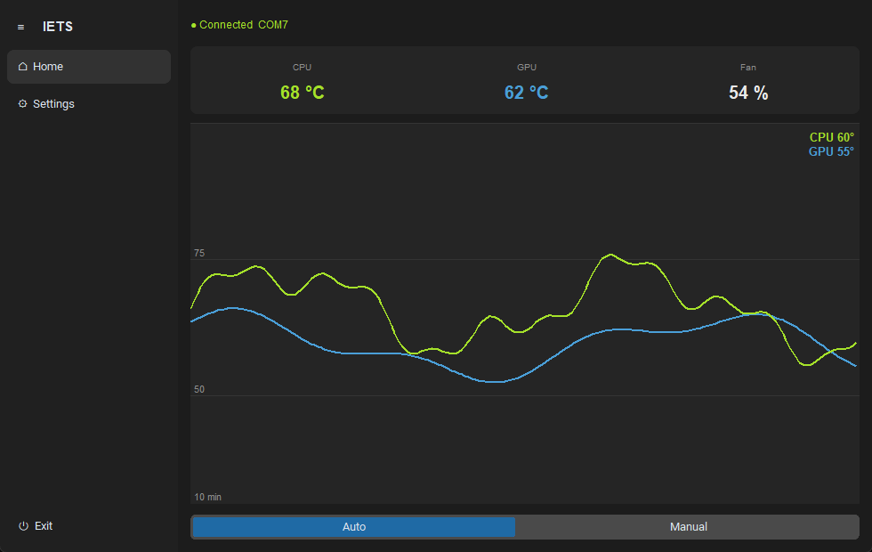
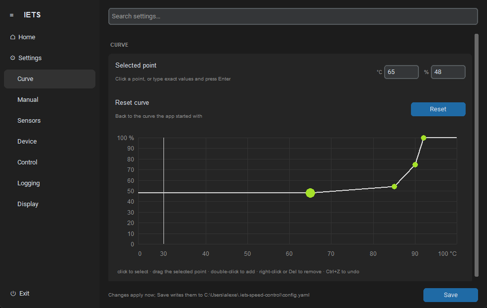
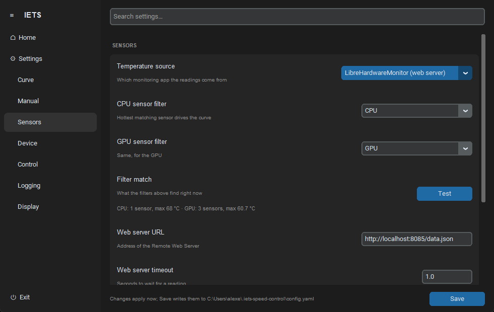
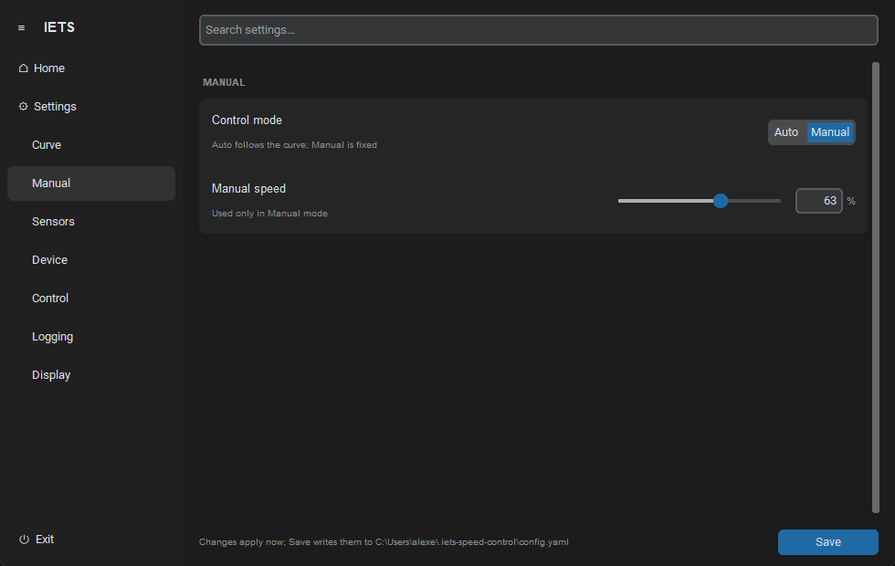
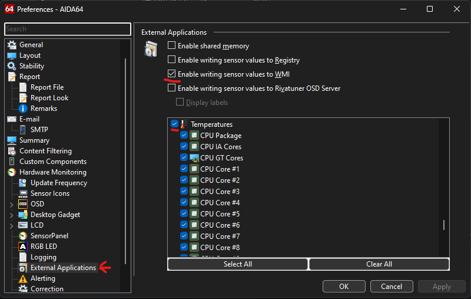

[](https://stand-with-ukraine.pp.ua)
[](https://stand-with-ukraine.pp.ua)
[](https://stand-with-ukraine.pp.ua)
[](https://stand-with-ukraine.pp.ua)

Control the PWM of your laptop cooling pad fan using ESP32 via USB, based on the Windows CPU/GPU temperatures that you choose to track, taken
from AIDA64, LibreHardwareMonitor, a Lenovo Legion laptop or the NVIDIA driver.



### How it works

- Reads temperatures from every source that has a tracked sensor, all at the same time
- Keeps the readings of the sensors that you track. A tracked sensor is one exact sensor name of one source
- Takes the hottest of them and maps it through the fan curve
- Sends PWM command (`Dimmer {value}` by default) to the serial device
- When there is nothing to go on, runs the fan at the default speed (`control.default_speed`, 50 % unless you change it)

### The interface

| | |
| --- | --- |
|  | **Curve** — the fan curve. Drag a selected point, double-click to add, `Del` to remove, `Ctrl+Z` to undo. The temperature axis is broken at 30 °C so the range worth editing gets the width |
|  | **Sensors** — the sensor picker. It lists every sensor that each source reports right now, and you tick the ones that drive the fan. The reading of each tracked sensor is shown, and the one that gives the maximum is marked |
|  | **Manual** — a fixed speed instead of the curve. The mode and the speed are both remembered between runs |

### Temperature Sources

Track sensors from one source or from several at once, in Settings → Sensors or under `sensors.tracked` in the config file (see [CONFIG.md](CONFIG.md)). A source is read while it is listed there, and one listed with no sensor drives nothing yet: Settings uses it to show what the source offers. The code name in the first column is the key in `sensors.tracked`:

| Code name    | Source                          | Notes                                                                                               |
|--------------|---------------------------------|-----------------------------------------------------------------------------------------------------|
| `aida64`     | AIDA64 via WMI                  | Paid, must stay running                                                                             |
| `lhm`        | LibreHardwareMonitor via WMI    | Free; falls back to the OpenHardwareMonitor namespace. Not every machine registers the WMI provider |
| `lhm-web`    | LibreHardwareMonitor web server | Free; works where the WMI provider does not                                                         |
| `lenovo-wmi` | Lenovo Legion embedded controller via WMI | Lenovo Legion laptops only; no monitoring app needed, but this app must run as administrator |
| `nvidia`     | NVIDIA display driver (NVAPI)   | NVIDIA GPUs only; no monitoring app and no administrator rights needed. Reads the GPU only, no CPU temperature |

Sensor names differ between sources, and two sources can use the same name, so the set is kept per source. The hottest tracked reading from any source drives the curve. A reading counts only when it is a live temperature between 0 °C (excluded) and 150 °C: sources report 0 °C for a sensor they lack, and a limit or a margin is not a temperature.

**Nothing tracked.** An empty set means monitoring is stopped: no reading drives the fan, and the fan runs at the default speed (`control.default_speed`, 50 % unless you change it). A fresh install starts this way, so pick the sensors in Settings → Sensors first.

**A source goes quiet.** If a source stops answering — AIDA64 closed, LibreHardwareMonitor's web server unreachable, or this app not elevated for `lenovo-wmi` — the tray icon turns red and Home says which source went quiet. The fan follows the hottest reading of the other tracked sources. When no tracked sensor has a reading at all, the fan runs at the default speed.

**A sleeping GPU.** An NVIDIA GPU that is powered off is cold, not broken: it does not turn the icon red. When every source that has a tracked sensor is asleep, the curve reads 0 °C and runs on its floor, not at the default speed.

**Stop and exit.** Stopping the control loop, and exiting the app, set the fan to the default speed as well, because nothing watches the temperatures any more.

**Breaking change.** `sensors.provider`, `sensors.filters`, `sensors.cpu_filter` and `sensors.gpu_filter` no longer exist. The app ignores them with a warning in the log, carries nothing over, and the next save drops them from the file. Pick the sensors again in Settings → Sensors, or write `sensors.tracked`. Until you do, nothing is tracked and the fan runs at the default speed.

#### AIDA64 Preparation

Getting CPU Temperature appeared to be harder on my Windows 11 i9-13900HX than flashing and connecting ESP32! The only
working way I found was AIDA64 via WMI. If you can get your CPU Temperature easier - good for you!

- Run AIDA64
- In AIDA64 Preferences->External Applications->Enable writing sensors to WMI
- In AIDA64 Preferences->External Applications0>Enable Temperature sensors
- Keep AIDA64 open



#### LibreHardwareMonitor Preparation

Common to both providers below:

- Run LibreHardwareMonitor as administrator — reading CPU temperatures needs kernel driver access
- Keep it open

Sensor coverage is per-chip, not universal. LibreHardwareMonitor inherits its hardware support from
OpenHardwareMonitor, whose [documentation](https://openhardwaremonitor.org/documentation/) enumerates the
supported CPU cores, mainboard chips (ITE, Fintek, Nuvoton, Winbond), GPUs, drives and fan controllers one by
one. If your chip is not on that list, no interface will produce a temperature for it — check what the
LibreHardwareMonitor window itself shows before blaming this app.

##### Via WMI (`lhm`)

Needs nothing beyond running as administrator: LibreHardwareMonitor publishes sensors to WMI on its own, under
the `root\LibreHardwareMonitor` namespace (`root\OpenHardwareMonitor` is tried as a fallback, and the original
interface is described in
[OpenHardwareMonitor-WMI.pdf](http://openhardwaremonitor.org/wordpress/wp-content/uploads/2011/04/OpenHardwareMonitor-WMI.pdf)).

Not every machine gets it. The namespace is registered at runtime, and on some systems it never appears even
with the app elevated and reporting temperatures in its own window — in that case the provider logs
`no temperature sensors found` and you want the web server below instead. Check yours with:

```powershell
Get-CimInstance -Namespace root/LibreHardwareMonitor -ClassName Sensor | Where-Object SensorType -eq Temperature
```

A list of sensors means the `lhm` provider will work. `The target namespace does not exist` means it will not,
no matter how the app is started.

Sensor labels here are the bare names LibreHardwareMonitor shows, such as `CPU Package` or `GPU Hot Spot`.

##### Via the web server (`lhm-web`)

Works wherever the app itself works, since it bypasses WMI entirely.

- Enable Options -> Remote Web Server -> Run
- Point `sensors.lhm_web.url` at it — default `http://localhost:8085/data.json`
- Raise `sensors.lhm_web.timeout` if the machine is slow to answer
- If you turned on Remote Web Server -> Authentication, set `sensors.lhm_web.username` and `.password` to match

Authentication is HTTP Basic (LibreHardwareMonitor serves the realm `Libre Hardware Monitor` and answers `401`
on a mismatch). The credentials are sent with the first request rather than after a challenge, and they travel
in plain base64 — keep the server on `localhost` or a trusted network. Wrong credentials are reported once per
poll as `rejected the credentials`, and any `user:password@` embedded in the URL is stripped from the log.

Labels are `<hardware>/<sensor>`, for example `NVIDIA GeForce RTX 4090 Laptop GPU/GPU Hot Spot`. Open
`sensors.lhm_web.url` in a browser to see the exact labels your machine reports.

LibreHardwareMonitor also reports entries under the Temperature type that are not live temperatures: `Distance to TjMax`, which *falls* as the chip heats up, fixed limits such as `Critical Temperature` or `Thermal Sensor High Limit`, and `Temperature Sensor Resolution`. Both LibreHardwareMonitor sources drop them, so none of them can be tracked to drive the fan. They are still visible in the LibreHardwareMonitor window.

#### Lenovo Legion Preparation (`lenovo-wmi`)

Reads the CPU, GPU and chipset (PCH) temperatures straight from the laptop's embedded controller, through Lenovo's own WMI class `LENOVO_OTHER_METHOD`. Lenovo Legion Toolkit uses the same class for its CPU and GPU temperatures. Neither it nor any other monitoring app has to run.

- Run IETS Speed Control as administrator. Windows refuses this WMI class to a process without administrator rights
- If the app runs without administrator rights, Settings -> Sensors shows a red note under the source selector, and Home shows `No temperatures from lenovo-wmi: restart as administrator`

The labels are `CPU`, `GPU` and `PCH`. Track `PCH` as well to let the chipset drive the fan. A model that does not report one of these sensors simply leaves it out. Check what your machine reports from an elevated PowerShell:

```powershell
$m = Get-CimInstance -Namespace root\WMI -ClassName LENOVO_OTHER_METHOD
Invoke-CimMethod -InputObject $m -MethodName GetFeatureValue -Arguments @{ IDs = 0x05040000 }  # CPU
```

The HWiNFO64 switch in the Lenovo Legion Toolkit settings is not needed for this source. That switch only shares fan speeds and the battery temperature with HWiNFO64.

#### NVIDIA Driver Preparation (`nvidia`)

Reads the GPU temperatures straight from the NVIDIA display driver, through `nvapi64.dll`, which every NVIDIA driver installs. No monitoring app has to run, and the app needs no administrator rights. It reads the first NVIDIA GPU only, and it reads no CPU temperature, so track a CPU sensor from another source next to it.

The labels are `GPU Core`, `GPU Hot Spot` and `GPU Memory Junction`, the same as in LibreHardwareMonitor. Track the ones you want, and the hottest of them drives the fan. A GPU that has no hot spot or memory junction sensor leaves that label out. An RTX 50 series card has no hot spot.

On a laptop with switchable graphics the NVIDIA GPU powers off when nothing uses it, and reading its temperature would power it on again. So the source asks the driver first whether the GPU is powered and returns no readings while it sleeps. If nothing else is tracked, the curve then runs on its floor until a program wakes the GPU. The source logs the sleep and the wake-up at debug level only.

Check what the driver says with `nvidia-smi --query-gpu=temperature.gpu --format=csv,noheader`. That number is the `GPU Core` reading. Hot spot and memory junction come from an NVAPI call that NVIDIA does not document, and they can be wrong or missing on a driver that changes it.

### Serial Device Preparation

Example: [ESP32_Tasmota](docs/ESP32_Tasmota.md)

- Connect your Serial Device via USB
- Attach a device pin to the fan PWM
- Attach the device Ground pin to the fan Ground

### Configuration

Everything is optional: without a config file the app runs on its defaults.

- Settings live in `%USERPROFILE%\.iets-speed-control\config.yaml`
- Only values you changed are written there — see [CONFIG.md](CONFIG.md) for the full schema
- Every setting is editable in the GUI, so the file is a convenience rather than a requirement:
  change what you need, then **Save** in the settings footer

### Script Execution

#### GUI

- Run `just gui`, or `uv run iets-speed-control-gui` without just
- **Home** shows the connection state, the maximum of the tracked sensors, the fan speed, every tracked sensor with its current reading (the one giving the maximum is marked with ▶), and a history graph of the maximum
  (ten minutes by default, adjustable in Settings -> Display)
- **Settings** covers every configuration key, one card per section, with a search box across them:
  - **Curve** is the fan curve editor. The temperature axis is broken at 30 °C: below that nothing
    interesting happens, so it is squashed into a narrow band and the rest of the width goes to the
    range worth editing. Click a point to select it, then drag it to move it;
    double-click to add, right-click or `Del` to remove, `Ctrl+Z` to undo. Undo is per session and
    is never written to the config file. Neighbouring points follow along so the curve stays
    monotonic, as in MSI Afterburner
  - **Sensors** picks the tracked sensors. It lists what every source reports now, and you tick the
    sensors that drive the fan, from any number of sources. The one that gives the maximum is marked
  - **Device** holds the serial settings; they take effect on **Reconnect**
  - **Control**, **Logging** and **Display** hold the tuning, log level, graph timeline and the
    start-minimized and minimize-to-tray switches
- The left rail collapses to icons with the `≡` button
- Changes apply as soon as they validate; a bad value is refused with the reason under the field
- **Save** writes the current state to the config file
- Starts minimized to the tray, and minimizing hides it there; both are switchable in
  Settings -> Display. The close button exits
- The window remembers its size and position, and ignores a saved position that is no longer on the
  desktop

#### Console

- Run `just cli`, or `uv run iets-speed-control` without just

#### Running it without cloning

`uvx` fetches, builds and runs it in one step, leaving nothing behind but its own cache:

```
uvx --from git+https://github.com/ALERTua/iets-speed-control iets-speed-control-gui
```

Swap the last word for `iets-speed-control` to get the console version. Pin a revision by appending
`@main` or `@<tag>` to the URL.

#### Launching the GUI without a console window

`iets-speed-control-gui.exe` is built as a GUI-subsystem program and has no console of its own. The
console window you get from `uv run iets-speed-control-gui` belongs to **`uv`**, which is a console
program itself. Either of these avoids it:

```
uvw run -m src.iets_speed_control.entrypoints.gui
```

### Seeing what it is doing

**Nothing is written to disk by default.** To watch the app work, run the console entrypoint — it prints
every reading and every change to the fan:

```
uv run iets-speed-control
```

```
2026-07-31 22:45:22 | INFO | iets_speed_control.controller | Max: 88 (nvidia/GPU Core). Dimmer: 75 -> 72
```

Launched without a console the GUI has nowhere to print, so if you need a record of a GUI session, turn a
log file on — Settings → Logging → **Use default**, or set `logging.file` to a path yourself. It rotates at
1 MB and keeps three of them.

- `logging.level` takes `DEBUG` / `INFO` / `WARNING` / `ERROR` / `CRITICAL`. `DEBUG` adds every reading and
  every smoothing decision; `INFO` reports only what changed
- Third-party libraries (`asyncio`, `wmi`, `comtypes`, `PIL`) stay at `WARNING` whatever you set, so raising
  the level shows this app's own detail rather than library noise
- Both settings apply immediately — no restart
